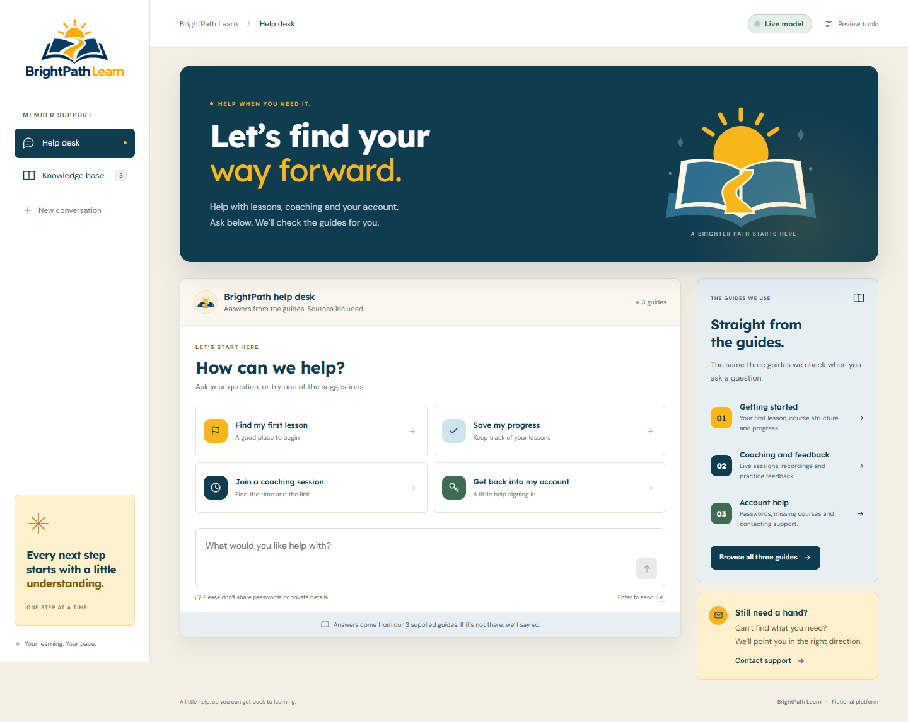

# BrightPath Learn · Help desk

A small, source-grounded help desk for the fictional learning platform in the practical-test brief. Designed around the supplied blue-and-yellow logo, with responsive layouts, readable source documents, passage citations, explicit unknown answers and recoverable errors.

[Open the live help desk](https://brightpath-learn-helpdesk.netlify.app) · [Source code](https://github.com/Chrismaboyi/brightpath-helpdesk)

The hosted app uses **Gemini 3.8 Flash**, with the key stored in a Netlify secret environment variable. A supported question and an unknown question have been checked against the real model; the third test deliberately simulates a failure. The same three checks also passed on the deployed site; see [`docs/deployed-test-results.json`](docs/deployed-test-results.json). Local setup works without a key in a clearly labelled demo mode.



## Run locally

Use Node.js 24 (Node 22+ is supported).

```sh
npm run dev
```

Open **http://localhost:8888**. There are no application runtime dependencies to install. The local Node server runs the same request handler as the Netlify Function. The visible transcript stays in browser memory. In live mode, the current question and fictional source facts are sent to Gemini; earlier turns are not sent. The app does not persist conversations or log their contents.

For the optional browser test tools:

```sh
npm ci
npx playwright install chromium
```

## Deploy on Netlify

### Fastest: drag-and-drop demo

Run `npm run build`, then drag the resulting **`dist` folder** into Netlify's manual deploy area. This serves a fully interactive, explicitly labelled browser-side mock, including citations, original documents, unknown answers and simulated failures. Static hosting does not deploy serverless functions or run a real model. The review panel identifies the static simulation.

To rebuild the folder after changing source:

```sh
npm run build
```

### Full application: Git-connected deployment

1. Put this project's contents in a GitHub repository, with `package.json` and `netlify.toml` at its root. Make the repository or downloadable code accessible to your reviewer.
2. In Netlify, import the repository. The included configuration supplies:
   - Build command: **`npm run build`**
   - Publish directory: **`dist`**
   - Functions directory: **`netlify/functions`**
   - Node version: **24**
3. Deploy. With no API key, the deployed Function serves the explicit demo.
4. To enable the real model, add **`GEMINI_API_KEY`** as a secret Netlify environment variable for the **production** context, including the Functions scope. On this account, Netlify uses its supported default secret scopes (Builds, Functions and Runtime); the app reads the key only in the server-side Function. Optionally set **`GEMINI_MODEL`** to an available `generateContent`-compatible model. The default is `gemini-3.8-flash`; availability depends on your Google AI account. Redeploy after changing environment variables.
5. Open the site. The badge switches to **Live model** when the server has a configured key. This indicates configuration, not a successful provider call. Use **Review tools → Run all three checks** to verify actual responses, then download the results.

For a full manual deployment with an installed Netlify CLI, run `netlify deploy --prod` from the project root and follow its project prompts. Deploy the project, not just `dist`, when you need the Function.

Never paste a provider key into the page, source code, `netlify.toml`, or your submission. `.env` files are ignored. No credentials are included in this project.

## Enable Gemini locally

Copy `.env.example` to `.env`, enter your own key and an available model, then restart `npm run dev`. The server loads this file. The browser communicates only with the same-origin `/api/ask` endpoint. If the provider fails, the app shows an error; it never quietly substitutes a mock for a failed live request.

Google references: [generateContent API](https://ai.google.dev/api/generate-content), [structured outputs](https://ai.google.dev/gemini-api/docs/structured-output). Netlify references: [Functions configuration](https://docs.netlify.com/build/functions/configuration/), [Functions environment variables](https://docs.netlify.com/build/functions/environment-variables/).

## How answering works

The supplied documents are preserved verbatim in `shared/documents.mjs`. Both modes use the same corpus.

**Demo mode:** a deliberately small keyword matcher chooses fixed source passages. Unsupported topics return an explicit “not available” response with the supplied fictional support address. It has no semantic understanding and can miss paraphrases or select a related but incomplete passage. There is no external model call.

**Live mode:** all three short documents fit in a single prompt, so there is no vector database or unnecessary retrieval infrastructure. Gemini returns structured JSON containing a support flag and fact IDs. The server validates those IDs and renders the corresponding **original source text**, rather than trusting generated prose. Each citation opens the full document and highlights the selected passages. Missing information returns a fixed abstention response without fabricated citations.

This extractive approach prevents the model from introducing new answer wording. It does **not** prove the chosen passages are relevant or complete; that requires live evaluation. Each question is independent. The UI keeps a transcript for reference but does not send previous turns to the model.

## Failure handling and testing

Open **Review tools → Try a failure in the chat** for a one-shot simulated HTTP 503. The error provides **Try again** and **Browse the guides**. Retrying uses a normal request, so recovery can be tested immediately. **Run all three checks** executes a supported question, an unknown question, and the failure simulation; results can be downloaded as JSON.

The provider call has a 15-second timeout. The handler rejects malformed input, limits question length to 1,000 characters and request bodies to 8 KB, rejects invalid model output and hides provider error bodies and secrets. The UI has its own request timeout, keyboard support, native modal dialogs, visible focus states and a reduced-motion preference.

```sh
npm test                 # Handler, grounding, validation and provider-failure fixtures
npm run test:results     # Reproduce the three saved mock-mode test cases
npm run test:browser     # UI, responsive layouts, recovery and accessibility
npm run build            # Produce dist/
```

The browser suite starts and stops its own local server. It requires the dev dependencies and a Playwright browser. To use an existing Chrome installation instead of downloading Chromium, set `PLAYWRIGHT_CHANNEL=chrome`. On PowerShell: `$env:PLAYWRIGHT_CHANNEL='chrome'; npm run test:browser`.

Evidence is in [`docs/TEST-RESULTS.md`](docs/TEST-RESULTS.md), [`docs/test-results.json`](docs/test-results.json) and [`docs/browser-results.json`](docs/browser-results.json). Browser screenshots are in `docs/screenshots/`. Provider responses in the unit tests are fixtures, not live model results. Actual model smoke-test responses are saved separately in [`docs/live-test-results.json`](docs/live-test-results.json). Automated accessibility checks cover the tested states and are not a full accessibility certification.

## Small code map

| File                        | Purpose                                           |
| --------------------------- | ------------------------------------------------- |
| `public/index.html`         | Semantic page, dialogs and original SVG icons     |
| `public/styles.css`         | Brand styling and responsive layouts              |
| `public/app.mjs`            | Conversation, source viewer and reviewer checks   |
| `shared/documents.mjs`      | Exact supplied documents and stable fact IDs      |
| `shared/demo.mjs`           | Explicit deterministic mock                       |
| `netlify/functions/ask.mjs` | Validation, Gemini integration and error handling |
| `scripts/dev.mjs`           | Dependency-free local HTTP server                 |
| `scripts/build.mjs`         | Static asset build                                |
| `tests/`                    | Handler and browser verification                  |

## Scope and next improvement

No sign-in, database, payments or invented platform content. The support address ends in `.example` and cannot receive email. The logo was supplied by the applicant. No third-party UI kit or starter template was used. Fonts are self-hosted DM Sans and Lexend, with their SIL Open Font License files in `public/assets/`.

The first improvement would be a live-model evaluation set covering paraphrases, ambiguous questions, partial support and prompt injection. Measure abstention accuracy and passage relevance before expanding the knowledge base. The two saved live cases are a smoke test, not a broad quality evaluation. Before exposing a paid model publicly, add durable rate limiting and operational monitoring; this bounded practical-test app does not include those production controls.

## AI assistance

This implementation was created with **OpenAI Codex assistance** for design, code, documentation and tests. It is original implementation work from the supplied brief and logo, rather than a reused template. Playwright and axe-core were used for browser checks. The hosted answer provider is Gemini. The unit tests use controlled provider fixtures, while `docs/live-test-results.json` records actual model calls.

